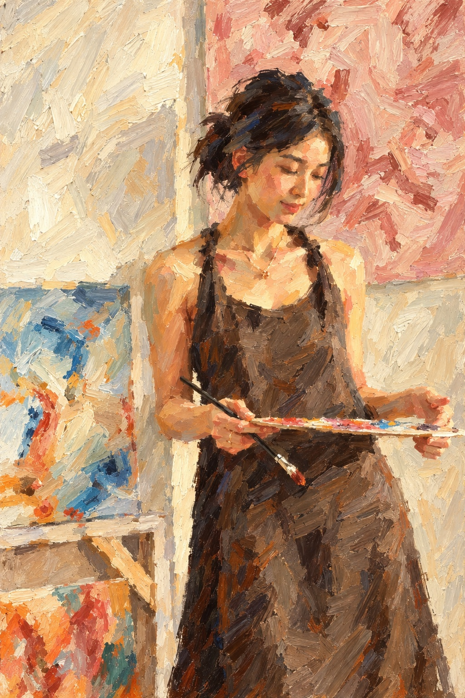
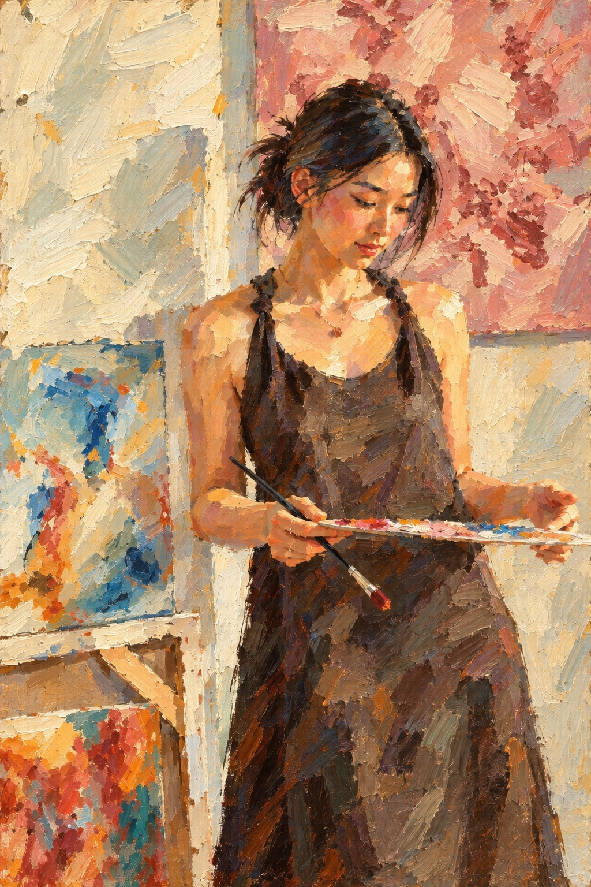
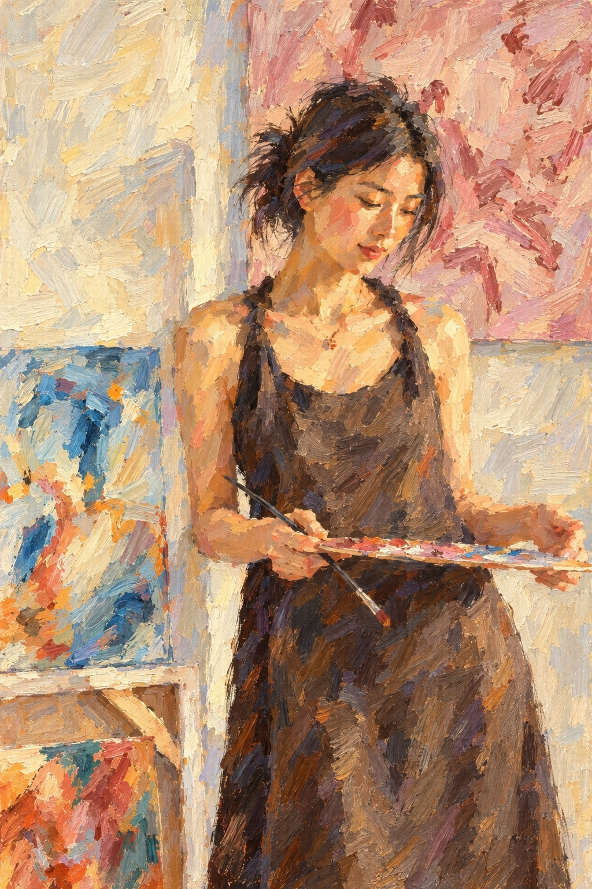

# Self-portrait variations

Generated in parallel with the built-in imagegen tool. The current showcase uses the colour-study variation as assets/self-portrait.jpg. The previous portrait was used as a pose, outfit and studio reference. These versions deliberately simplify the facial features and skin into visible paint strokes.

## Loose impressionist

Use case: style-transfer. Create a genuinely hand-painted-looking self-portrait variation using the supplied existing portrait solely as a pose, wardrobe and studio composition reference. Subject: a slender young adult Asian woman, clearly in her twenties, with dark hair loosely tied back, delicate natural facial proportions, looking gently down at a paint palette in her hands; wearing a simple charcoal-brown sleeveless painter's apron. Keep the relaxed three-quarter standing pose, paintbrush, cream studio wall and soft pink canvas behind her, pale blue painting at the left. Retain the person's overall impression but prioritize a visibly expressive painting over exact photographic likeness. Loose impressionist oil painting with broad wet-on-wet bristle-brush strokes. Build the face from a few flat, visible patches of peach, warm ochre, rose and muted green shadows. Soft lost-and-found contours. Eyes and lips indicated with two or three deliberate marks, not detailed rendering. Hair in large expressive dark brush shapes, no individual strands. Cream and dusty rose studio background, warmly luminous. Hand-painted and slightly imperfect. Crucial: this must NOT be a photo with a paint texture overlaid. Reconstruct the entire face, neck, shoulders, arms and hands out of broad obvious paint strokes and simplified colour planes; no photorealistic face or skin, no smooth beauty retouching, no pores or individual eyelashes, no lens effects, no photographic lighting, no cinematic grading. The face must be as painterly as the surrounding room. Portrait aspect ratio 2:3, full bleed flat reproduction of a single painted canvas, no border, no frame, no text, no signature, no watermark.

## Palette knife

Use case: style-transfer. Create a genuinely hand-painted-looking self-portrait variation using the supplied existing portrait solely as a pose, wardrobe and studio composition reference. Subject: a slender young adult Asian woman, clearly in her twenties, with dark hair loosely tied back, delicate natural facial proportions, looking gently down at a paint palette in her hands; wearing a simple charcoal-brown sleeveless painter's apron. Keep the relaxed three-quarter standing pose, paintbrush, cream studio wall and soft pink canvas behind her, pale blue painting at the left. Retain the person's overall impression but prioritize a visibly expressive painting over exact photographic likeness. Bold expressive impasto oil painting, built with chunky palette-knife planes and square-ended brush dabs, an intimate studio portrait with tactile thick paint. Angular simplified facial planes, strong strokes of peach, pale gold, burnt sienna and dusty mauve; muted sage shadow accents. Skin is painted with the same coarse decisive strokes as the apron and background. Reduce anatomical detail and make every patch of the image a visible paint decision. An elegant finished painting, not crude. Crucial: this must NOT be a photo with a paint texture overlaid. Reconstruct the entire face, neck, shoulders, arms and hands out of broad obvious paint strokes and simplified colour planes; no photorealistic face or skin, no smooth beauty retouching, no pores or individual eyelashes, no lens effects, no photographic lighting, no cinematic grading. The face must be as painterly as the surrounding room. Portrait aspect ratio 2:3, full bleed flat reproduction of a single painted canvas, no border, no frame, no text, no signature, no watermark.

## Colour study - selected

Use case: style-transfer. Create a genuinely hand-painted-looking self-portrait variation using the supplied existing portrait solely as a pose, wardrobe and studio composition reference. Subject: a slender young adult Asian woman, clearly in her twenties, with dark hair loosely tied back, delicate natural facial proportions, looking gently down at a paint palette in her hands; wearing a simple charcoal-brown sleeveless painter's apron. Keep the relaxed three-quarter standing pose, paintbrush, cream studio wall and soft pink canvas behind her, pale blue painting at the left. Retain the person's overall impression but prioritize a visibly expressive painting over exact photographic likeness. A lyrical post-impressionist oil colour study, loose flat shapes, broken edges and a soft hand-drawn quality. Painterly anatomy with slightly imperfect proportions, face suggested through broad blocks of warm cream, salmon and rose with blue-grey shadows. Leave a little warm underpainting showing between strokes. Muted lilac, butter yellow, dusty pink and ochre studio colours. Deliberately unfinished passages in hands and apron, still a finished gallery-worthy painting. No smooth gradients. Crucial: this must NOT be a photo with a paint texture overlaid. Reconstruct the entire face, neck, shoulders, arms and hands out of broad obvious paint strokes and simplified colour planes; no photorealistic face or skin, no smooth beauty retouching, no pores or individual eyelashes, no lens effects, no photographic lighting, no cinematic grading. The face must be as painterly as the surrounding room. Portrait aspect ratio 2:3, full bleed flat reproduction of a single painted canvas, no border, no frame, no text, no signature, no watermark.
